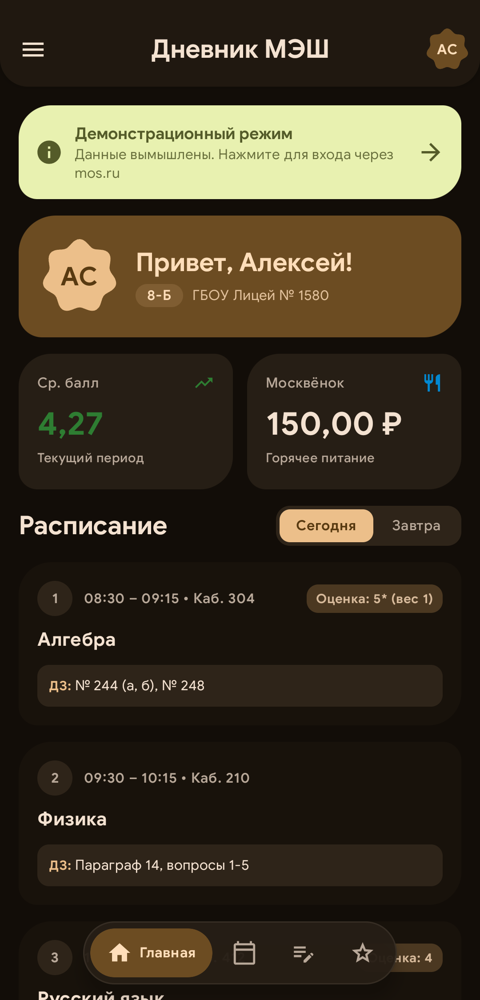
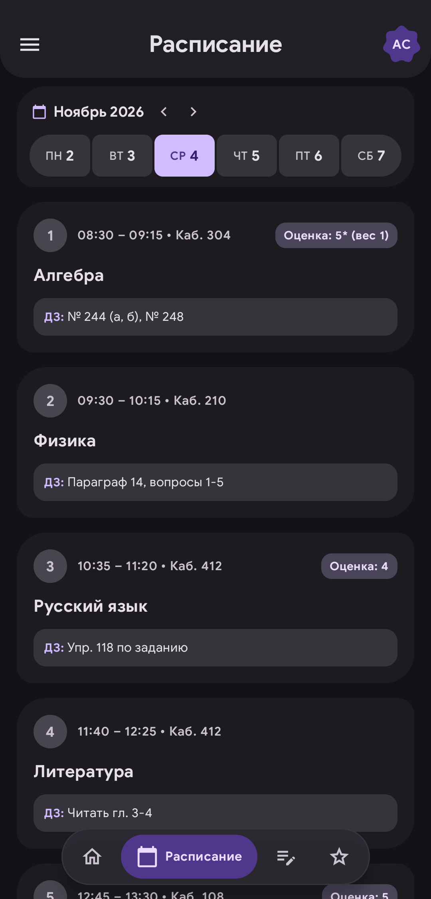
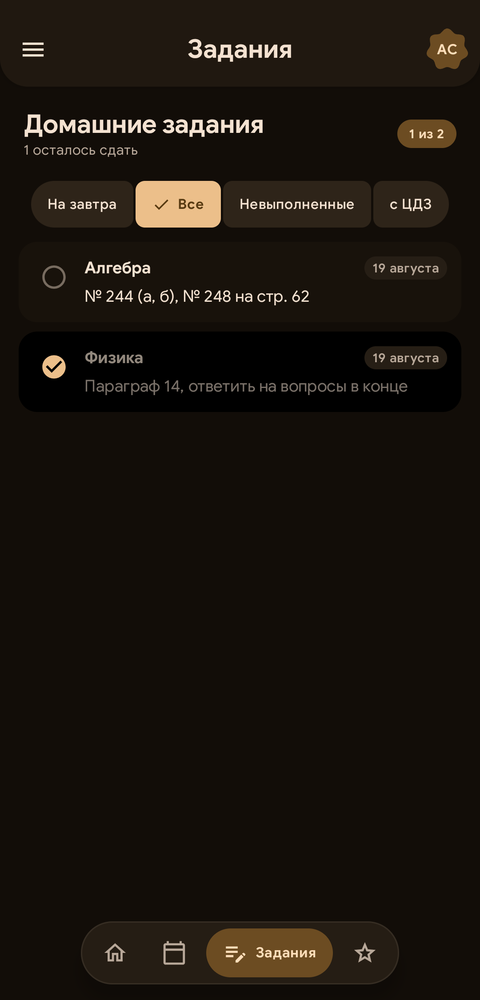
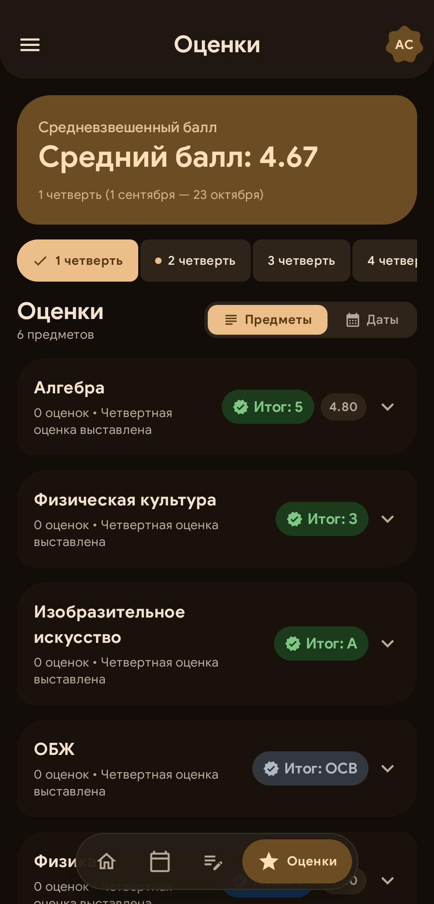
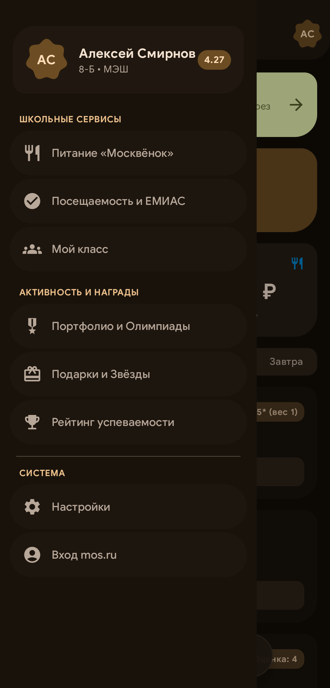

# Дневник МЭШ Expressive

Быстрый, приватный клиент Московской электронной школы в дизайн-системе Material Design 3 Expressive с нулевым количеством встроенных трекеров.

[](https://github.com/ametistik1337/mesh_expressive/releases/latest)
[](https://www.android.com/)
[](https://kotlinlang.org/)
[](https://developer.android.com/jetpack/compose)
[](https://github.com/ametistik1337)
[](https://github.com/ametistik1337)
[](LICENSE)

---

<p align="center">
  
  
  
  
  
</p>

---

## Функционал

### Оценки и аттестация
- Честный расчет общего и средневзвешенного GPA без скрытых скруглений API.
- Учет истекших точек в текущем среднем балле и в истории дат.
- Отображение замененных точек со звездочкой `*` и история изменений оценки в шторке урока.
- Динамический переключатель периодов (M3 Connected Buttons) с автоопределением активной четверти или семестра.
- Корректное отображение четвертной аттестации (выставленные итоговые отметки относятся к завершенному периоду).
- Поддержка нечисловых зачетов: «З» (Зачтено), «А» (Аттестован), «ОСВ» (Освобожден), «Н/А» (Не аттестован).
- Калькулятор оценок: расчет количества пятерок для достижения целевого среднего балла.

### Расписание и уроки
- Календарная сетка занятий с переключением дней недели через Connected Button Group.
- Интерактивная шторка урока с темой, кабинетом, учителем, прикрепленными тестами и шкалой успеваемости класса.
- Точные секунды выставления оценок и дедлайнов.
- Автоматический расчет производственного календаря и шторка графика каникул.

### Домашние задания
- Компактный список заданий с центрированными фильтрами: «На завтра», «Все», «Невыполненные», «с ЦДЗ».
- Встроенное решение тестов ЦДЗ прямо в приложении без перехода в браузер.
- Загрузка решений (фото, документы) через официальный эндпоинт вложений с системным пикером файлов.

### Деанонимизация рейтинга класса
- Раскрытие анонимизированных участников школьного рейтинга путем сопоставления personId, contingentGuid и связей параллели.
- Просмотр рейтингов по отдельным школьным предметам.
- Инспектор профилей с быстрым копированием идентификаторов.

### Школьные сервисы
- Баланс карты питания «Москвёнок», лимит трат и история операций в буфете.
- Точное время прохода через турникеты и активные медицинские справки из системы ЕМИАС.
- Портфолио: дипломы, грамоты и олимпиады по категориям и этапам (от школьного до заключительного).
- Геймификация: витрина наград, сдача тестов за звезды и отправка подарков одноклассникам.

### Сеть, автономность и приватность
- Фоновое бесшовное обновление JWT-токена через легковесный WebView без сброса пользовательской сессии.
- Полнофункциональный офлайн-режим с локальным кэшированием всех ключевых данных в SessionManager.
- Полное отсутствие рекламных и трекинговых SDK: вырезаны Yandex AppMetrica, Спутник МЭШ, VK MyTracker, OK Tracer, Sentry APM и Varioqub.

---

## Архитектура и стек

- Язык: Kotlin 2.0
- UI: Jetpack Compose, Material Design 3 Expressive
- Архитектура: MVVM, unidirectional data flow (UDF), Kotlin Coroutines & StateFlow
- Сеть: Retrofit, OkHttp, GSON
- Хранилище: Защищенный локальный кэш (EncryptedSharedPreferences / SessionManager)
- Сборка: Gradle (Kotlin DSL)

---

## Сборка и установка

```bash
git clone https://github.com/ametistik1337/mesh_expressive.git
cd mesh_expressive
./gradlew assembleRelease
```

Готовый APK находится по пути:
`app/build/outputs/apk/release/app-release.apk`
