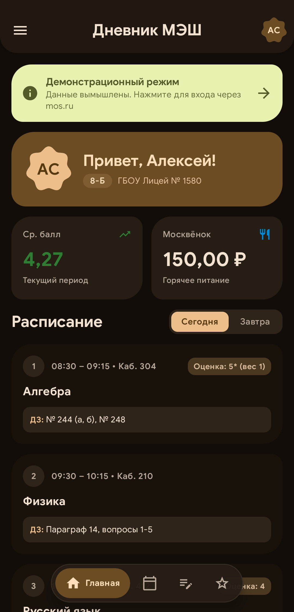
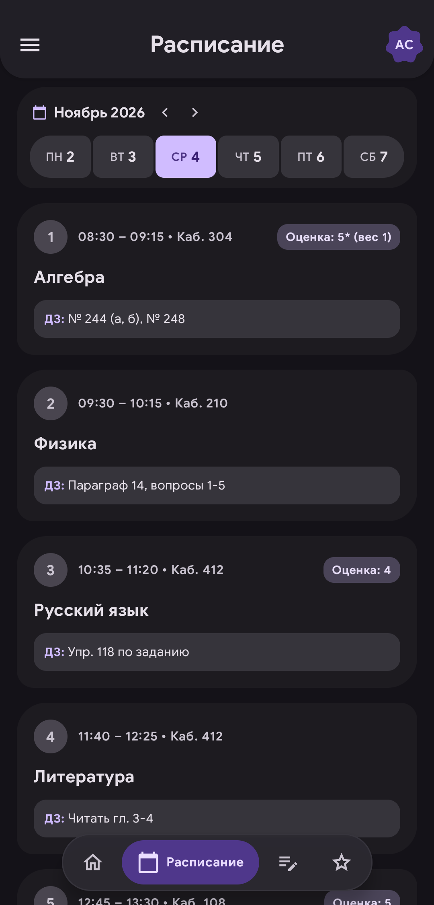
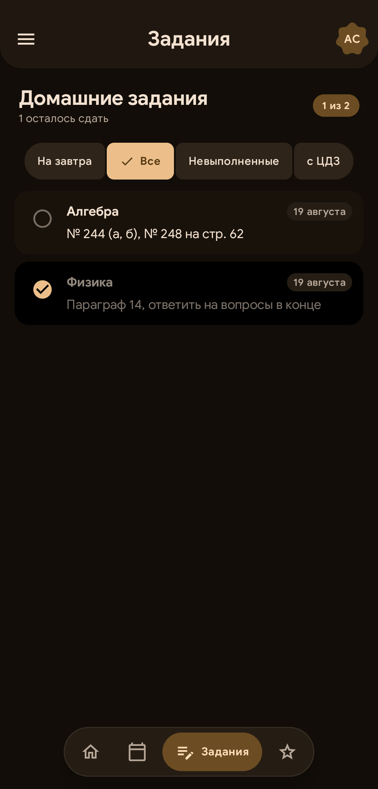
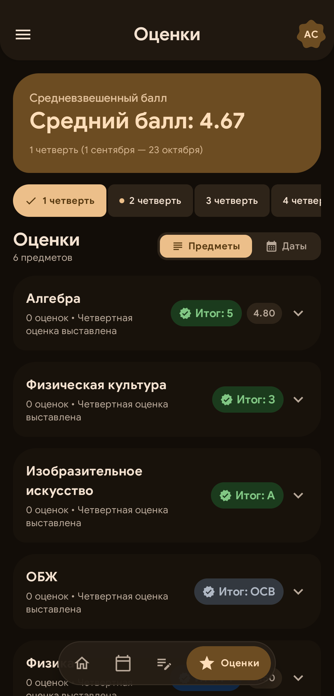
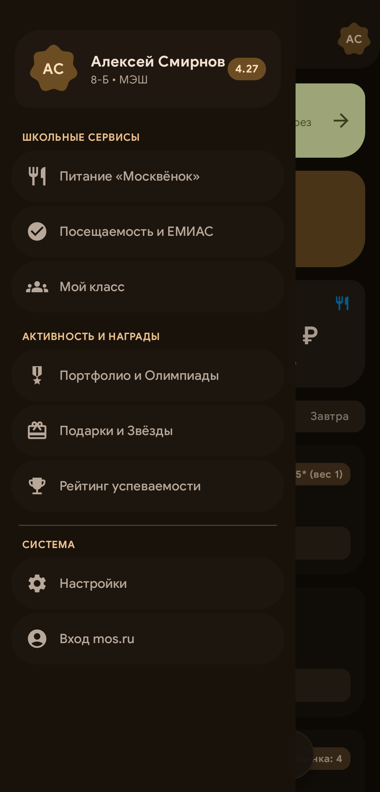

# Дневник МЭШ Expressive (borichdev fork)

> [!IMPORTANT]
> # 🌟 ОРИГИНАЛЬНЫЙ ПРОЕКТ И АВТОРСТВО
> **Этот репозиторий является форком потрясающего проекта [Expressive MESH](https://github.com/ametistik1337/mesh_expressive), созданного разработчиком [@ametistik1337](https://github.com/ametistik1337).**
>
> Все лавры, признание и авторские права на первоначальную концепцию, архитектуру и стильный интерфейс принадлежат исключительно **Аметисту**:
> 👉 **Оригинальный проект:** [https://github.com/ametistik1337/mesh_expressive](https://github.com/ametistik1337/mesh_expressive)
>
> Данный форк (`borichdev/mesh_expressive`) развивает проект дальше: оперативные хотфиксы боевого API, нативная работа с файлами учителя, AMOLED-тема и синхронизация серверных показателей.

[](https://github.com/ametistik1337/mesh_expressive)
[](https://github.com/borichdev/mesh_expressive)
[](https://www.android.com/)
[](https://github.com/ametistik1337)
[](LICENSE)

---

<p align="center">
  
  
  
  
  
</p>

---

## Что добавлено и улучшено в этом форке

- **Файлы от учителя («ФАЙЛЫ ОТ УЧИТЕЛЯ»):**
  - Поддержка вложений к урокам и домашним заданиям напрямую из боевого API МЭШ.
  - Определение реальных типов файлов (`.pdf`, `.odt`, `.doc`/`.docx`, `.xls`/`.xlsx`, `.ppt`/`.pptx`, `.zip`/`.rar`, изображения).
  - Скачивание файлов с авторизационными токенами в папку `Загрузки` устройства.
  - Нативное открытие и просмотр через системный Chooser (`Intent.ACTION_VIEW` + `FileProvider`) во внешних ридерах (Camelot, WPS, LibreOffice и др.).
  - Разделение кнопок «Скачать» и «Открыть» прямо в шторках урока и ДЗ.
- **Официальный средний балл и рейтинг:**
  - Полная синхронизация со средним баллом официального сервера МЭШ (без расхождений и локальных искажений).
  - Информационная плашка с разъяснением серверных ночных пересчётов позиций в классе.
  - Поддержка полугодовых учебных периодов (1-е полугодие, 2-е полугодие, год) наравне с четвертями.
- **AMOLED Black тема:**
  - Настоящий глубокий чёрный цвет для экономии батареи и визуального комфорта на OLED-экранах.
- **Посещаемость и ЕМИАС:**
  - Объединённый таймлайн проходов через турникеты и школьных уроков.
  - Компактное отображение уважительных причин («Уваж.») в единую строку без скачков вёрстки.
  - Учёт справок по болезни и автоматическая фильтрация пропусков.

---

## Базовый функционал

### Оценки и аттестация
- Учет истекших точек в текущем среднем балле и в истории дат.
- Отображение замененных точек со звездочкой `*` и история изменений оценки в шторке урока.
- Динамический переключатель периодов (M3 Connected Buttons) с автоопределением активной четверти или семестра.
- Корректное отображение четвертной аттестации (выставленные итоговые отметки относятся к завершенному периоду).
- Поддержка нечисловых зачетов: «З» (Зачтено), «А» (Аттестован), «ОСВ» (Освобожден), «Н/А» (Не аттестован).
- Калькулятор оценок: расчет количества пятерок для достижения целевого среднего балла.

### Расписание и уроки
- Календарная сетка занятий с переключением дней недели через Connected Button Group.
- Интерактивная шторка урока с темой, кабинетом, учителем, прикрепленными тестами и файлами.
- Автоматический расчет производственного календаря и шторка графика каникул.

### Домашние задания
- Компактный список заданий с фильтрами: «На завтра», «Все», «Невыполненные», «с ЦДЗ».
- Встроенное решение тестов ЦДЗ прямо в приложении без перехода в браузер.
- Чистый интерфейс с фокусом на материалах учителей.

### Деанонимизация рейтинга класса
- Раскрытие анонимизированных участников школьного рейтинга путем сопоставления personId, contingentGuid и связей параллели.
- Просмотр рейтингов по отдельным школьным предметам.
- Инспектор профилей с быстрым копированием идентификаторов.

### Школьные сервисы
- Баланс карты питания «Москвёнок», лимит трат и история операций в буфете.
- Точное время прохода через турникеты и активные медицинские справки из системы ЕМИАС.
- Портфолио: дипломы, грамоты и олимпиады по категориям и этапам.
- Геймификация: витрина наград, сдача тестов за звезды и отправка подарков одноклассникам.

### Сеть, автономность и приватность
- Фоновое бесшовное обновление JWT-токена через легковесный WebView без сброса пользовательской сессии.
- Полнофункциональный офлайн-режим с локальным кэшированием всех ключевых данных в SessionManager.
- Полное отсутствие рекламных и трекинговых SDK: вырезаны Yandex AppMetrica, Спутник МЭШ, VK MyTracker, OK Tracer, Sentry APM и Varioqub.

---

## Архитектура и стек

- **Язык:** Kotlin 2.0
- **UI:** Jetpack Compose, Material Design 3 Expressive
- **Архитектура:** MVVM, Unidirectional Data Flow (UDF), Kotlin Coroutines & StateFlow
- **Сеть:** Retrofit, OkHttp, GSON
- **Хранилище:** Защищенный локальный кэш (EncryptedSharedPreferences / SessionManager)
- **Сборка:** Gradle (Kotlin DSL)

---

## Сборка и установка

```bash
git clone git@github.com:borichdev/mesh_expressive.git
cd mesh_expressive
./gradlew assembleRelease
```

Готовый APK находится по пути:
`app/build/outputs/apk/release/app-release.apk`
